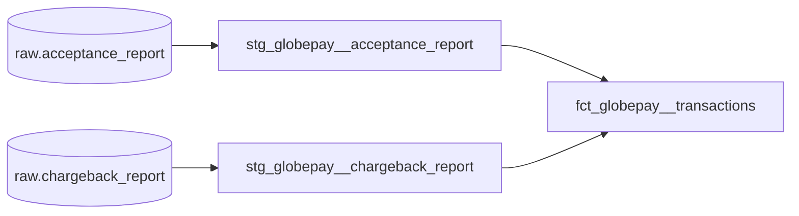

# Deel Analytics Engineering Challenge

## How to run

Built with dbt Core (dbt-snowflake) on Snowflake.

**1. Load the raw data into Snowflake.** Create a `GLOBEPAY` database with a
`RAW` schema, then load the two challenge CSVs as tables (Snowsight's "Load data"
wizard works, and it picks up the column names from the CSV headers):

| CSV | Table |
|---|---|
| globepay_acceptance_report.csv | `GLOBEPAY.RAW.ACCEPTANCE_REPORT` |
| globepay_chargeback_report.csv | `GLOBEPAY.RAW.CHARGEBACK_REPORT` |

**2. Install dbt.**

```bash
python -m venv .venv
source .venv/bin/activate
pip install -r requirements.txt
```

**3. Set up the connection.** Copy `profiles.example.yml` to `~/.dbt/profiles.yml`
and set the environment variables it uses. Change the role and warehouse if yours
are named differently. Models are built in `GLOBEPAY.ANALYTICS`.

```bash
export SNOWFLAKE_ACCOUNT=<your_account>
export SNOWFLAKE_USER=<your_user>
export SNOWFLAKE_PASSWORD=<your_password>
```

**4. Build.**

```bash
dbt deps     # installs dbt_utils
dbt debug    # checks the connection
dbt build    # builds the models and runs all tests
```

`dbt build` should finish with 34 passes and 1 warning. The warning is expected,
it flags the one negative amount described below.

`dbt docs generate && dbt docs serve` opens the documentation site with the
lineage graph.

## PART 1

## 1. Preliminary data exploration

Two CSVs (acceptance report and chargeback report) were given with no schema, plus
the Globepay API spec. I loaded both files into Snowflake as they were 
and profiled them there before building anything.

### acceptance_report

Row Total: 5,430 rows

| Column | Type | Notes |
|---|---|---|
| external_ref | text | Unique and never null, so this is the primary key |
| status | boolean | Always TRUE, dropped it in staging |
| source | text | Always GLOBALPAY, dropped it in staging|
| ref | text | Unique `evt_...` id |
| date_time | timestamp | UTC, from 2019-01-01 to 2019-06-30 |
| state | text | 3,777 ACCEPTED and 1,653 DECLINED |
| cvv_provided | boolean | Only 40 rows are TRUE |
| amount | number | Local currency |
| country | text | AE, CA, FR, MX, UK, US with 905 rows each |
| currency | text | USD, CAD, EUR, GBP, MXN. One currency per country (AE and US are both USD) |
| rates | text | JSON of FX rates per 1 USD, e.g. `{"CAD":1.4150668250112406,"EUR":0.9247504902895055,"MXN":25.09984809423505,"USD":1,"SGD":1.4386656744040172,"AUD":1.6522932076675718,"GBP":0.8176652602309986}` |

### chargeback_report

Row Total: 5,430 rows

| Column | Type | Notes |
|---|---|---|
| external_ref | text | Unique, and matches the acceptance report 1:1 with no orphans either way |
| status | boolean | Always TRUE, dropped it in staging |
| source | text | Always GLOBALPAY, dropped it in staging |
| chargeback | boolean | 223 TRUE (about 4%), never null |

### Additional Notes

- Amounts are in local currency, so they have to be converted to USD before
  aggregating. For example, MXN amounts are roughly 25x bigger than USD ones, and
  summing raw amounts gives the wrong picture. 
- There is one negative amount: -23.78 GBP on an accepted transaction
  (`SPm_aqm_Rrer_6jxpLvO2`). It's probably a refund or a data error.
- Every transaction has a chargeback record.
- The API spec doesn't match the data in a few places, so I went with the data:
  - `external_ref` is described as the card expiry year but shows with `evt_` id
  - The example response puts the `evt_` id in `external_ref`, but in the data
    it's in `ref`.

## 2. Model architecture

```
models/
  staging/globepay/
    sources.yml
    schema.yml
    stg_globepay__acceptance_report.sql
    stg_globepay__chargeback_report.sql
  marts/globepay/
    schema.yml
    fct_globepay__transactions.sql
macros/
  convert_to_usd.sql
```

The project follows the usual staging and marts split.

Sources: `sources.yml` points at the two raw tables in `GLOBEPAY.RAW` and
tests them as they come in.

Staging (views): There is one model per raw table, and each stays 1:1 with
its source. These models only rename, cast and do simple row-level calculations.
`stg_globepay__acceptance_report` 
  - renames the columns such as `external_ref` to `transaction_id` and `date_time` to `transaction_ts`
  - drops `status` and `source`
  - parses the transaction's rate out of the JSON as `fx_rate_to_usd` 
  - calculates `amount_usd`. 

`stg_globepay__chargeback_report`
  - drops `status` and `source`
  - renames columns

Marts (table): `fct_globepay__transactions` is the table analysts should
use. It has one row per transaction, built by left joining the chargebacks onto
the acceptance data.

| Column | Description |
|---|---|
| transaction_id | Primary key (Globepay `external_ref`) |
| globepay_reference_id | Globepay reference id (`evt_...`) |
| transaction_ts | Transaction timestamp (UTC) |
| transaction_date | Date of the transaction |
| transaction_state | ACCEPTED or DECLINED |
| is_cvv_provided | Whether the CVV was given |
| country_code | Country as sent by Globepay |
| currency_code | Currency of the local amount |
| amount_local | Amount in local currency |
| fx_rate_to_usd | Local currency per 1 USD at the time of the transaction |
| amount_usd | amount_local / fx_rate_to_usd, rounded to cents |
| is_chargeback | Whether it was charged back. Null means there's no chargeback record |

Some decisions I made along the way:

- I didn't add an intermediate layer. With two sources and a simple 1:1 join it
  would just be an extra hop. I'd add one if FX rates came from their own table,
  or if a second payment provider needed the same conversion logic.
- The USD conversion lives in staging. Every row carries its own rate, so it's a
  row-level calculation and doesn't need a join or any business rules.
- Each model sets its materialization in its own `config()` block.
- I didn't add clustering or incremental logic. At about 5k rows Snowflake's
  automatic micro-partitioning is plenty. In production I'd make the fact table
  incremental on `transaction_ts`, and only add a clustering key if query
  performance called for it.

## 3. Lineage



## 4. Tips on macros, data validation and documentation

### Macros

`convert_to_usd(amount, fx_rate_to_usd)` divides the amount by the rate and
rounds to cents. It's a small macro, but it means the conversion rule lives in
one place. This makes conversion consistent across the project.

I'd keep macros like this small and give them simple inputs. This one takes a
rate that's already a number rather than the raw JSON, which makes it easier to
reuse and test. Before writing a macro, check dbt_utils first since it already has most common tests.

### Data validation

Added data tests at different levels:

- **Source:** `external_ref` is unique and not null. There are also warnings in
  case `status` or `source` stop being constant. They're dropped in staging, so
  I want to know if they ever start meaning something.
- **Staging:** primary keys are unique and not null. `transaction_state` is
  either ACCEPTED or DECLINED. `fx_rate_to_usd` and `amount_usd` aren't null,
  which catches a currency missing from the rates JSON. Every chargeback must
  match a transaction. There is also a warning if `amount_local` is negative.
- **Mart:** `transaction_id` is unique and not null, and the fact table has the
  same row count as the acceptance model, so the join can't add or lose rows.

I set severity for each test. I used errors for anything
that would make the numbers wrong, like duplicate keys or a missing state. I used
warnings for things worth looking at that shouldn't stop the pipeline. The
negative amount check currently warns on the -23.78 GBP transaction, which I'd raise with Globepay
rather than let the build fail.

Next steps would be source freshness checks once the data arrives on a schedule,
and a unit test for `convert_to_usd`.

### Documentation

Model and column descriptions live in a `schema.yml` next to the models, so
`dbt docs` picks them up along with the lineage. The descriptions cover the things
that aren't obvious from the data.

Naming conventions help as well: 
- `stg_` prefix for staging models and `fct_` prefix for marts
- `is_` for booleans
- `_ts` for timestamps
- `_usd` / `_local` suffixes for amounts


## PART 2

### The model

Everything for this part comes from one table:
`globepay.analytics.fct_globepay__transactions`. It has one row per payment
attempt, so counting rows counts transactions. A few things to know when using it:

- Use `amount_usd` for any totals across countries. `amount_local` is in each
  country's own currency, so it can't be summed across countries.
- `transaction_state` is either ACCEPTED or DECLINED.
- `transaction_date` is in UTC. Use `date_trunc` on it to group by week or month.
- `is_chargeback` is null when a transaction has no record in the chargeback
  report. That's how missing chargeback data shows up.

The results of each query, run in Snowflake, are in [results_snowflake.pdf](results_snowflake.pdf).

### Q1. What is the acceptance rate over time?

Acceptance rate = accepted transactions / all transactions, grouped by month.

```sql
select
    date_trunc('month', transaction_date) as transaction_month,
    count(transaction_id) as total_transactions,
    count(case when transaction_state = 'ACCEPTED' then transaction_id end) as accepted_transactions,
    round(
        count(case when transaction_state = 'ACCEPTED' then transaction_id end)
        / count(transaction_id) * 100,
        1
    ) as acceptance_rate_pct
from globepay.analytics.fct_globepay__transactions
group by 1
order by 1;
```

The acceptance rate is fairly stable at around 70% (69.6% overall). It dips to
67.8% in April and is highest in June at 71.7%. Swapping `'month'` for `'week'` or
`'day'` gives a more detailed view.

### Q2. List the countries where the amount of declined transactions went over $25M

```sql
select
    country_code,
    count(transaction_id) as declined_transactions,
    sum(amount_usd) as declined_amount_usd
from globepay.analytics.fct_globepay__transactions
where transaction_state = 'DECLINED'
group by 1
having sum(amount_usd) > 25000000
order by declined_amount_usd desc;
```

Four countries went over $25M: FR, UK, AE and US.


### Q3. Which transactions are missing chargeback data?

```sql
select
    transaction_id,
    transaction_ts,
    country_code,
    transaction_state,
    amount_usd
from globepay.analytics.fct_globepay__transactions
where is_chargeback is null
order by transaction_ts;
```

The query returns 0 rows. Every transaction in the acceptance report has a
matching record in the chargeback report.

Note that the model is set up to catch this. The fact table left joins
the chargebacks onto the transactions, so a transaction without a chargeback
record is kept with `is_chargeback` as null, instead of being dropped. The
chargeback column itself is tested as never null, so a null in the fact table
can only mean the record is missing.
